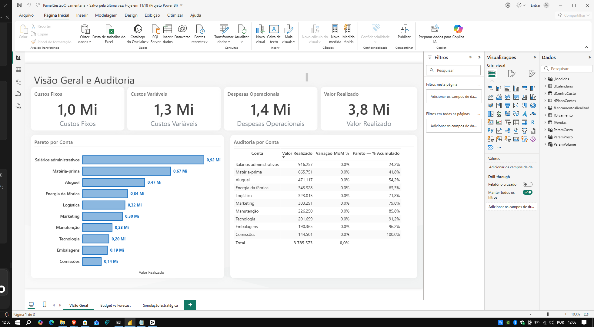
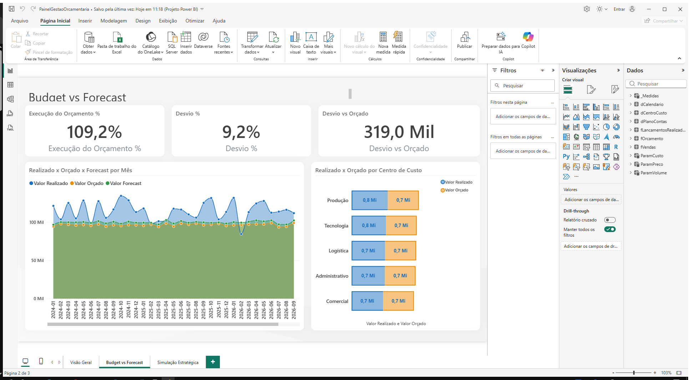
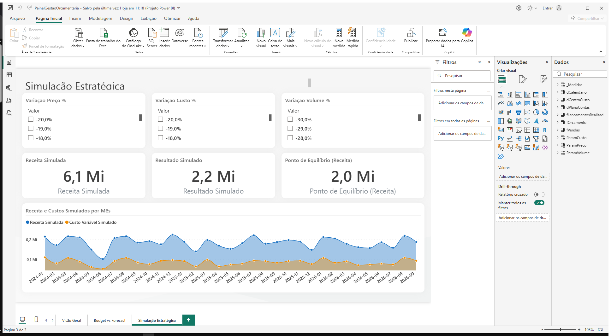

# Painel de Gestão Orçamentária e Performance

Relatório de **Business Intelligence** para acompanhamento orçamentário, controle de execução
(Budget vs. Forecast) e **simulação estratégica what-if** (preço, custo e volume), construído em
Power BI Desktop no formato **projetizado (`.pbip` + TMDL)** e pronto para versionamento no GitHub.

> **Dados 100% sintéticos e fictícios.** Todas as tabelas foram geradas para demonstração e prática
> e **não representam nenhuma empresa real**.

[](https://powerbi.microsoft.com/)
[](LICENSE)
[-green)](#-estrutura-do-projeto)
[-lightgrey)](#)

---

## 📸 Demonstração

| Visão Geral | Budget vs. Forecast | Simulação Estratégica |
| --- | --- | --- |
|  |  |  |

---

## ✨ Funcionalidades

- **Visão Geral** — cartões de custos fixos, custos variáveis, despesas operacionais e valor total
  realizado; gráfico de Pareto por conta do plano de contas (com % acumulado); tabela de auditoria
  com a variação mês a mês (MoM).
- **Budget vs. Forecast** — linha/colunas por `AnoMes` comparando **Realizado × Orçado × Forecast**,
  barras por centro de custo e cartões de **execução do orçamento (%)** e **desvio (valor e %)**.
- **Simulação Estratégica** — segmentadores *what-if* de **Preço**, **Custo** e **Volume**, cartões de
  **Receita Simulada**, **Resultado Simulado** e **Ponto de Equilíbrio**, além do gráfico mensal
  comparando receita e custos simulados.
- **27 medidas DAX** organizadas na tabela `_Medidas`: valores realizados, desvios, acumulados,
  MoM, Pareto e todo o motor de simulação what-if.
- **Modelo estrela** com 3 dimensões, 3 fatos, 3 parâmetros desconectados e 7 relacionamentos
  de filtro único.
- **Projeto versionável** em TMDL — diff legível no Git, sem binário `.pbix` no repositório.

---

## 🛠️ Tecnologias

| Ferramenta | Uso |
| --- | --- |
| [Power BI Desktop](https://powerbi.microsoft.com/desktop/) | Autoria do relatório e do modelo |
| Formato **PBIP + TMDL** | Definição textual do modelo semântico |
| **DAX** | Medidas de execução, desvio, acumulado, Pareto e simulação |
| **Power Query (M)** | Transformação da base |
| **Tema JSON embutido** | Identidade visual do relatório (`Highrise`) |
| **Git / GitHub** | Versionamento do projeto |

---

## 📦 Instalação

**Pré-requisitos**

- [Power BI Desktop](https://powerbi.microsoft.com/desktop/) atualizado (suporte a projetos **PBIP/TMDL**).
- Habilitar: **Arquivo → Opções → Opções do Power BI Desktop → Pré-visualizações →
  Formato de arquivo do projeto (Power BI Project)**, se ainda não estiver ativo.

**Baixar o repositório**

```powershell
git clone https://github.com/<seu-usuario>/<seu-repo>.git
cd <seu-repo>
```

---

## ⚙️ Configuração

### Abrir o projeto pronto

1. Dê **duplo clique** em `PainelGestaoOrcamentaria.pbip`.
2. Aguarde o carregamento do modelo semântico e do relatório.
3. Use os segmentadores da página **Simulação Estratégica** para explorar os cenários *what-if*.

### Montar do zero (sem abrir o `.pbip`)

1. **Obter Dados → Excel** e importe `Base_PowerBI_Gestao_Orcamentaria.xlsx`.
2. Selecione as **seis abas/tabelas** e carregue.
3. Crie os 7 relacionamentos descritos em **Estrutura do projeto** e marque `dCalendario` como
   **Tabela de datas**.
4. Crie a tabela `_Medidas` com as medidas de
   `PainelGestaoOrcamentaria.SemanticModel/definition/tables/_Medidas.tmdl`.
5. Crie os parâmetros *what-if* (Modelagem → Novo parâmetro → Intervalo de valores):

   | Parâmetro | Faixa | Passo | Padrão |
   | --- | --- | --- | --- |
   | `ParamPreco` | −20% a +20% | 1% | 0% |
   | `ParamCusto` | −20% a +30% | 1% | 0% |
   | `ParamVolume` | −30% a +50% | 1% | 0% |

6. Monte as três páginas conforme a seção **Como usar**.

> O `.pbix` final é gerado apenas pelo Power BI Desktop (**Arquivo → Salvar como**). Este pacote
> fornece a base e as fórmulas para montá-lo, mas não gera um `.pbix` automaticamente.

---

## 🚀 Como usar

Após abrir o relatório:

1. **Visão Geral** — acompanhe custos, despesas e o Pareto de contas; a tabela de auditoria mostra
   a variação MoM de cada conta.
2. **Budget vs. Forecast** — filtre por ano, mês e centro de custo para comparar realizado, orçado
   e forecast e verificar execução/desvio.
3. **Simulação Estratégica** — mova os três segmentadores de preço, custo e volume para projetar
   receita, resultado e ponto de equilíbrio em tempo real.

**Medidas em destaque**

```dax
Valor Realizado = CALCULATE(SUM(fLancamentosRealizados[Valor]))

Valor Orçado =
    CALCULATE(SUM(fOrcamento[Valor]), fOrcamento[Cenario] = "Budget")

Execução do Orçamento % = DIVIDE([Valor Realizado], [Valor Orçado])

Desvio % = DIVIDE([Desvio vs Orçado], [Valor Orçado])

Receita Simulada =
    SUMX(fVendas,
        fVendas[Unidades] * (1 + [Variação Volume %])
        * fVendas[PrecoUnitario] * (1 + [Variação Preço %]))

Resultado Simulado = [Margem de Contribuição Simulada] - [Custos Fixos Base]

Ponto de Equilíbrio (Receita) =
    DIVIDE([Custos Fixos Base], [Margem de Contribuição %])
```

A lista completa está em
`PainelGestaoOrcamentaria.SemanticModel/definition/tables/_Medidas.tmdl`.

**Publicar no GitHub**

```powershell
git add .
git commit -m "feat: painel de gestão orçamentária com simulação what-if"
git push
```

---

## 📁 Estrutura do projeto

```
.
├── PainelGestaoOrcamentaria.pbip              # Arquivo de projeto (abre no Power BI Desktop)
├── PainelGestaoOrcamentaria.Report/           # Definição do relatório (JSON/TMDL)
│   └── definition/pages/…                     # 3 páginas e 21 visuais
├── PainelGestaoOrcamentaria.SemanticModel/    # Modelo semântico (TMDL)
│   └── definition/
│       ├── tables/                            # 3 dimensões, 3 fatos, 3 parâmetros, _Medidas
│       ├── relationships.tmdl                 # 7 relacionamentos (1:*, filtro único)
│       └── model.tmdl
├── Base_PowerBI_Gestao_Orcamentaria.xlsx      # Base de dados (6 abas/tabelas)
├── screenshots/                               # Imagens usadas neste README
└── .pbir/                                     # Metadados de estado do Power BI Desktop
```

### Modelo de dados (esquema estrela)

| Tabela | Papel |
| --- | --- |
| `dCalendario` | Dimensão de datas (**tabela de datas** oficial) |
| `dPlanoContas` | Dimensão de contas (Custo Fixo, Custo Variável, Despesa Operacional) |
| `dCentroCusto` | Dimensão de centros de custo |
| `fLancamentosRealizados` | Fato — lançamentos realizados |
| `fOrcamento` | Fato — orçamento (cenários `Budget` e `Forecast`) |
| `fVendas` | Fato — vendas (unidades, preço unitário, custo variável unitário) |
| `ParamPreco` / `ParamCusto` / `ParamVolume` | Tabelas desconectadas de parâmetro *what-if* |
| `_Medidas` | Todas as medidas DAX |

Relacionamentos (direção de filtro única, das dimensões para as fatos):

- `dCalendario[Data]` 1:\* `fLancamentosRealizados[Data]`, `fOrcamento[Data]`, `fVendas[Data]`
- `dPlanoContas[ContaID]` 1:\* `fLancamentosRealizados[ContaID]`, `fOrcamento[ContaID]`
- `dCentroCusto[CentroCustoID]` 1:\* `fLancamentosRealizados[CentroCustoID]`, `fOrcamento[CentroCustoID]`

---

## 🧪 Testes

Checklist de validação após abrir o relatório:

- [ ] O modelo carrega sem erros e `dCalendario` está marcada como **Tabela de datas**.
- [ ] Os 7 relacionamentos aparecem com filtro **único**, das dimensões para as fatos.
- [ ] Cartões de **Visão Geral** exibem valores (custos fixos, variáveis e despesas).
- [ ] O Pareto soma 100% no último item e a tabela de auditoria calcula a Variação MoM %.
- [ ] **Budget vs. Forecast** mostra as três séries por `AnoMes` e os cartões de execução/desvio.
- [ ] Ao mover os segmentadores, **Receita Simulada**, **Resultado Simulado** e
      **Ponto de Equilíbrio** respondem imediatamente.
- [ ] Retornando os parâmetros a 0%, os valores simulados coincidem com a base original.

---

## 🚢 Deploy

- **Power BI Service** — publique o `.pbix` salvo pelo Desktop em **Arquivo → Salvar como →
  Power BI (.pbix)** e faça o upload em [app.powerbi.com](https://app.powerbi.com).
- **Microsoft Fabric** — o formato PBIP/TMDL pode ser publicado como item de *Power BI Dataset*
  e *Power BI Report* usando a extensão do **Power BI Projects** para VS Code ou o pipeline do
  Power BI Project.
- **Atualização da base** — substitua `Base_PowerBI_Gestao_Orcamentaria.xlsx` e atualize a
  origem em **Transformar dados → Atualizar**.

---

## 🗺️ Roadmap

- [ ] Publicar o relatório no Power BI Service com gateway para a base.
- [ ] Adicionar página de análise de desvios por centro de custo com drill-through.
- [ ] Incluir cenários adicionais (Best Case / Worst Case) no orçamento.
- [ ] Automatizar a geração da base sintética.
- [ ] Adicionar alertas de desvio (KPI) no Power BI Service.
- [ ] Traduzir o relatório para inglês.

---

## 🤝 Contribuindo

Contribuições são bem-vindas! Siga estes passos:

1. Faça um **fork** do repositório.
2. Crie uma branch para a sua alteração: `git checkout -b feature/minha-melhoria`.
3. Faça as alterações mantendo o padrão TMDL/DAX existente.
4. Valide o relatório com o checklist da seção **Testes**.
5. Abra um **Pull Request** descrevendo a motivação e o impacto.

**Diretrizes**

- Não commitar arquivos locais do Power BI (`.pbi/localSettings.json`, `.pbi/cache.abf`) —
  o `.gitignore` já os cobre.
- Manter os nomes de medidas e tabelas em português, conforme `_Medidas`.
- Dados do repositório são sintéticos: não inserir informações reais de empresas.

---

## 📄 Licença

Distribuído sob a licença [MIT](LICENSE). Consulte o arquivo para mais detalhes.

Aviso: os dados são **sintéticos e fictícios**, criados exclusivamente para fins de estudo e
demonstração.
